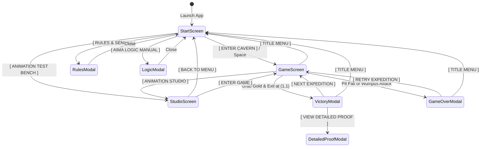

# Pixel Wumpus World: Caverns of Logic - Design Specification

**Date:** 2026-10-21  
**Project:** Pixel Wumpus World (AIMA Propositional Logic & Dark Fantasy 2D Engine)  
**Repository:** `https://github.com/DiepTuHuy/pixel-wumpus.git`  
**Author:** Pair Programming (Google DeepMind Antigravity & User)

---

## 1. System Overview & Vision

Pixel Wumpus World is an authentic retro-fantasy 2D adaptation of Russell & Norvig's classic **Wumpus World** (Artificial Intelligence: A Modern Approach - AIMA). The game combines:
1. **Dark Fantasy Celestial Visuals**: 8-bit royal navy (`#090e24`) and antique gold filigree (`#e8ca74`), pure CSS pixel-diamond corner accents, and universal pixel typography (`Press Start 2P`).
2. **Dynamic 2D Torchlight Engine**: Realistic radial torch lighting centered precisely on the player's coordinate, casting atmospheric glow with smooth falloff and ambient dark cavern vignette.
3. **High-Fidelity Pixel Archer**: Custom 360x460 pixel archer sprites featuring an intact hood, dynamic directional flip (`scaleX = 1 / -1`), and a 4-phase forward stride walk cycle (`walk0` -> `walk1` -> `walk2` -> `walk3`).
4. **Verifiable AIMA Propositional Logic Engine**: Clause resolution (`KB ∧ ¬α ⊢ ⊥`) running live in the background, generating mathematical proofs for safe moves and Wumpus elimination.
5. **Polished Start Screen & User Flow**: Title screen with atmospheric idle preview, comprehensive rules modal, AIMA logic manual, instant animation test bench, and seamless navigation.

---

## 2. Visual & Architectural Constraints

1. **Universal Typography**:
   - Every text element, button, HUD label, modal, and formula strictly uses `'Press Start 2P', monospace`.
   - All UI text is localized in English to ensure 100% uniform Latin-1 glyph rendering without fallback font substitution.
2. **Icon & Emoji Constraint**:
   - Strictly **zero emojis or external icon fonts** anywhere across the entire application.
   - The only allowed symbols are the 4 directional arrows on the movement d-pad (`◄`, `▲`, `▼`, `►`) and pure CSS geometric shapes (e.g. 45° rotated pixel diamonds for frame accents).
3. **Responsive Dark Fantasy Frames**:
   - Frames built with multi-layered CSS borders, antique gold gradients, inset celestial shadows, and pure CSS corner diamonds. No blurry raster slicing.
4. **Standalone Portability**:
   - Production bundle runs seamlessly offline or hosted on GitHub Pages with zero external build step dependencies.

---

## 3. Screen States & User Flow

### 3.1 Start Screen (Title Screen)
- **Title Banner**: `WUMPUS WORLD: CAVERNS OF LOGIC` in embossed retro gold with glowing halo.
- **Centerpiece Display**: Cavern opening with the 2D archer breathing in idle state, surrounded by glowing torchlight halo and drifting golden embers.
- **Action Menu**:
  - `[ ENTER CAVERN ]`: Begins dungeon expedition.
  - `[ RULES & SENSES ]`: Opens perception & scoring guide.
  - `[ AIMA LOGIC MANUAL ]`: Opens propositional calculus & clause resolution overview.
  - `[ ANIMATION STUDIO ]`: Opens full motion bench.
  - `[ AUDIO: ON / OFF ]`: Toggles Web Audio synthesizer.

### 3.2 Game Screen (Expedition)
- **Header HUD**: Score tracker, Arrow status, Current Coordinate `(x, y)`, Active Senses (Stench, Breeze, Glitter, Bump, Scream), `[ TITLE MENU ]` button.
- **Dungeon Grid (4x4 Canvas)**:
  - Coordinate system from `(1,1)` (bottom-left) to `(4,4)` (top-right).
  - Fog of War covering unvisited rooms.
  - Centered radial torchlight illuminating visited rooms and immediate surroundings.
  - Visual icons/sprites: Archer, Wumpus (alive/dead), Pit chasms, Glittering Gold chest.
- **Control D-Pad**: 4 movement buttons (`◄`, `▲`, `▼`, `►`), `GRAB GOLD`, `SHOOT ARROW`.
- **AIMA Proof Stream**: Real-time terminal log displaying logic deductions made after each step.

### 3.3 Animation Studio (Test Bench)
- Filmstrip of all 10 assets (`idle0`, `idle1`, `walk0`-`walk3`, `shoot0`-`shoot2`, `arrow`).
- Modes: Treadmill vs Forward Stride (traversing across the dark fantasy stone floor).
- Controls: Play/Pause, Step Next/Prev, Speed slider (0.2x, 0.5x, 1x, 2x), Light toggle, Shoot bow & launch arrow.

---

## 4. AIMA Logic & Resolution Engine Specification

### 4.1 Propositional Variables
- $P_{x,y}$: Pit at room $(x,y)$.
- $W_{x,y}$: Wumpus at room $(x,y)$.
- $B_{x,y}$: Breeze at room $(x,y)$.
- $S_{x,y}$: Stench at room $(x,y)$.
- $OK_{x,y} \iff \neg P_{x,y} \wedge \neg W_{x,y}$: Room is guaranteed safe.

### 4.2 Axioms & Knowledge Base
- $B_{x,y} \iff \bigvee_{(i,j) \in \text{Adj}(x,y)} P_{i,j}$
- $S_{x,y} \iff \bigvee_{(i,j) \in \text{Adj}(x,y)} W_{i,j}$
- Exactly one Wumpus in the cave: $\bigvee_{(x,y)} W_{x,y} \wedge \bigwedge_{(x,y) \neq (i,j)} (\neg W_{x,y} \vee \neg W_{i,j})$.

### 4.3 Clause Resolution Refutation Proof
To prove a room $(x,y)$ is safe ($OK_{x,y}$):
1. Assert $\neg OK_{x,y} \iff (P_{x,y} \vee W_{x,y})$.
2. Add $\neg OK_{x,y}$ to $KB$.
3. Resolve complementary literals $L$ and $\neg L$ until reaching the empty clause $\square$ (Contradiction).
4. Therefore, $KB \models OK_{x,y}$.

---

## 5. Scoring & Game Rules
- Initial Score: $1000$ points.
- Action Cost: $-1$ per forward move or turn.
- Arrow Cost: $-10$ per arrow shot (1 arrow available).
- Pit Fall: $-1000$ (Death).
- Wumpus Attack: $-1000$ (Death if entering alive Wumpus room).
- Grab Gold: $+1000$.
- Escape at `(1,1)`: Expedition completed successfully.

---

## 6. Implementation Deliverables
1. `index.html`: Complete, self-contained, responsive production application with Start Screen, Game Board, Studio, Modals, AIMA Engine, Audio Synthesizer, and Base64 sprites.
2. `README.md`: Professional project documentation including features, architecture, game controls, AIMA theorem proving explanation, and GitHub Pages setup.
3. Git Repository initialized with initial commit and pushed to `https://github.com/DiepTuHuy/pixel-wumpus.git`.
